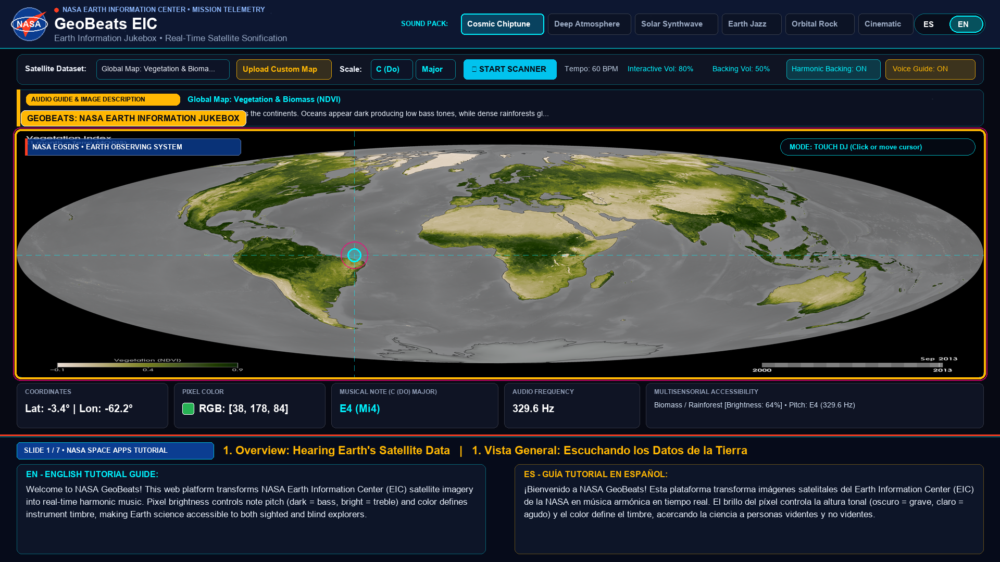
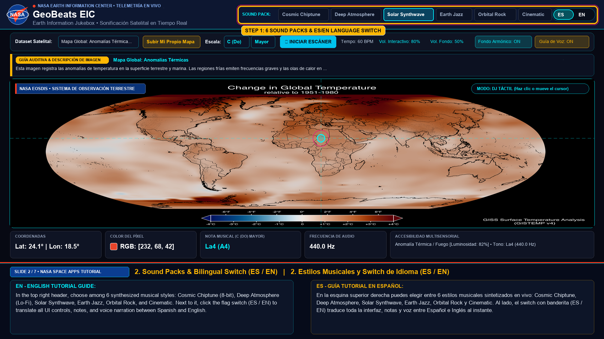
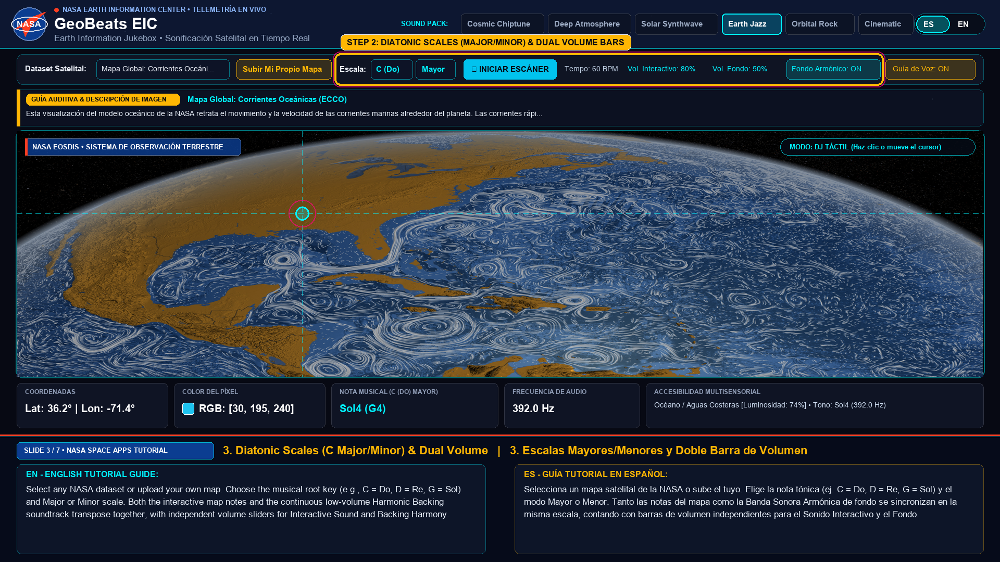
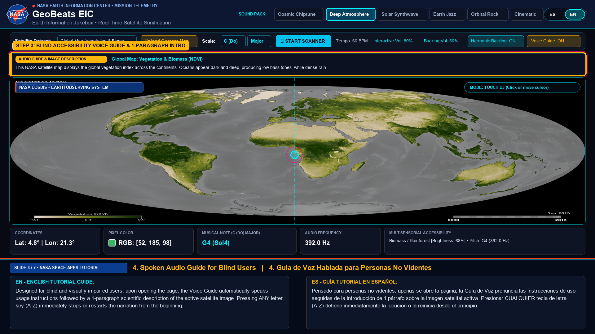
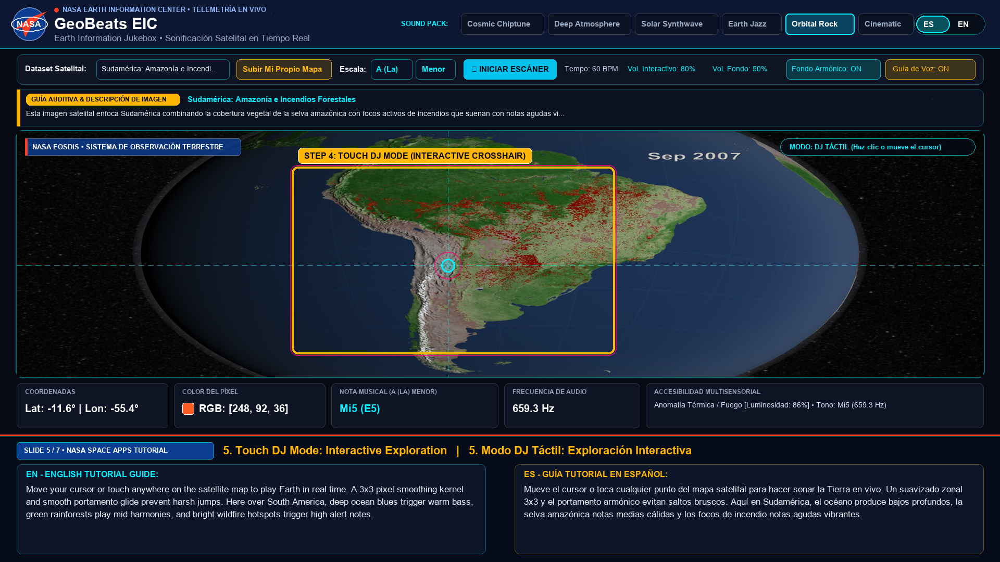
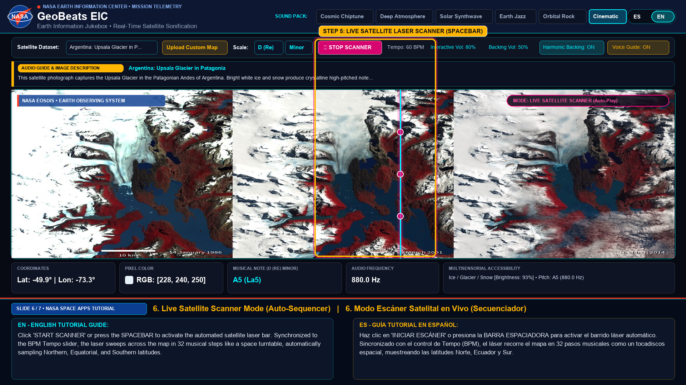
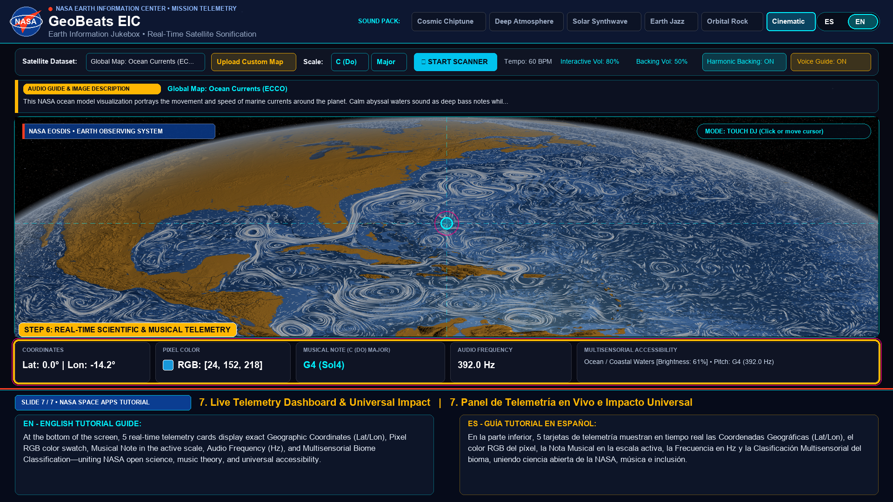

# GeoBeats: Earth Information Jukebox — 7-Slide Project Demonstration (EN / ES)

**NASA Space Apps Challenge — Official 7-Slide Demonstration & Interactive Tutorial**  
📄 **[Download / View Full 7-Slide PDF (`GeoBeats_NASA_7_Slides.pdf`)](./GeoBeats_NASA_7_Slides.pdf)**

---

## Slide 1 / 7 — Overview: Hearing Earth's Satellite Data | Vista General: Escuchando los Datos de la Tierra

- **🇺🇸 English Tutorial Guide:** Welcome to **NASA GeoBeats**! This web platform transforms NASA Earth Information Center (EIC) satellite imagery into real-time harmonic music. Pixel brightness controls note pitch (dark = bass, bright = treble) and color defines instrument timbre, making Earth science accessible to both sighted and blind explorers.
- **🇪🇸 Guía Tutorial en Español:** ¡Bienvenido a **NASA GeoBeats**! Esta plataforma transforma imágenes satelitales del Earth Information Center (EIC) de la NASA en música armónica en tiempo real. El brillo del píxel controla la altura tonal (oscuro = grave, claro = agudo) y el color define el timbre, acercando la ciencia a personas videntes y no videntes.

---

## Slide 2 / 7 — Sound Packs & Bilingual Switch (EN / ES) | Paquetes de Sonido e Idioma (EN / ES)

- **🇺🇸 English Tutorial Guide:** In the top header, choose between **6 synthesizer styles**: *Cosmic Chiptune, Deep Atmosphere, Solar Synthwave, Earth Jazz, Orbital Rock,* and *Cinematic*. On the right, click the **ES / EN** toggle button to switch all interface labels and spoken voice narrations between Spanish and English instantly.
- **🇪🇸 Guía Tutorial en Español:** En la barra superior, elige entre **6 estilos musicales**: *Chiptune Cósmico, Atmósfera Profunda, Synthwave Solar, Jazz Terrestre, Rock Orbital* y *Cinematográfico*. A la derecha, usa el botón **ES / EN** para cambiar todos los textos y la narración por voz entre Español e Inglés al instante.

---

## Slide 3 / 7 — Datasets, 12 Musical Keys, Scales & Volume | Mapas, 12 Tonalidades, Escalas y Volumen

- **🇺🇸 English Tutorial Guide:** Select **10 preloaded NASA satellite datasets** (MODIS, Terra, Aqua, VIIRS, Suomi NPP, OMI, GRACE) or upload your own map. Choose any of the **12 musical keys (`C` to `B`)** in full 7-note **Major** or **Natural Minor** scales, and balance **Interactive Sound** and **Background Harmony** volumes independently.
- **🇪🇸 Guía Tutorial en Español:** Selecciona **10 mapas satelitales precargados de la NASA** (MODIS, Terra, Aqua, VIIRS, Suomi NPP, OMI, GRACE) o sube tu propio mapa. Elige cualquiera de las **12 tonalidades (`Do` a `Si`)** en escala **Mayor** o **Menor Natural** de 7 notas, y ajusta por separado el volumen interactivo y el acompañamiento armónico.

---

## Slide 4 / 7 — Accessibility for Blind Users & Voice Guide | Accesibilidad para No Videntes y Voz

- **🇺🇸 English Tutorial Guide:** Designed for blind and low-vision users: the **Voice Guide** automatically reads a welcoming tutorial and a scientific description of each satellite image. Press **any letter key (`A–Z`)** on your keyboard at any time to stop or restart the spoken narration from the beginning, or **SPACEBAR** to toggle the scanner.
- **🇪🇸 Guía Tutorial en Español:** Diseñado para personas no videntes: la **Guía por Voz** lee automáticamente una bienvenida explicativa y la descripción científica de cada mapa satelital. Presiona **cualquier tecla de letra (`A–Z`)** en tu teclado para detener o reiniciar la narración desde el principio, o **ESPACIO** para activar el escáner.

---

## Slide 5 / 7 — Interactive Touch DJ Mode (Manual Exploration) | Modo Touch DJ (Exploración Manual)

- **🇺🇸 English Tutorial Guide:** Move your mouse cursor or drag your finger across the satellite canvas to play Earth like an instrument in real time. A neon ripple highlights your exact coordinates while the synthesizer translates pixel color and brightness into musical notes harmonized with the background pad.
- **🇪🇸 Guía Tutorial en Español:** Mueve el cursor del mouse o desliza tu dedo sobre el lienzo satelital para tocar la Tierra como un instrumento en tiempo real. Un destello señala tus coordenadas exactas mientras el sintetizador traduce el color y brillo del píxel en notas musicales armonizadas con el fondo.

---

## Slide 6 / 7 — Live Satellite Scanner Mode (Auto-Sequencer) | Modo Escáner Satelital en Vivo (Secuenciador)

- **🇺🇸 English Tutorial Guide:** Click **START SCANNER** or press the **SPACEBAR** to activate the automated satellite laser bar. Synchronized to the BPM Tempo slider, the laser sweeps across the map in 32 musical steps like a space turntable, automatically sampling Northern, Equatorial, and Southern latitudes.
- **🇪🇸 Guía Tutorial en Español:** Haz clic en **INICIAR ESCÁNER** o presiona la **BARRA ESPACIADORA** para activar el barrido láser automático. Sincronizado con el control de Tempo (BPM), el láser recorre el mapa en 32 pasos musicales como un tocadiscos espacial, muestreando las latitudes Norte, Ecuador y Sur.

---

## Slide 7 / 7 — Real-Time Telemetry HUD & Scientific Impact | Telemetría en Tiempo Real e Impacto

- **🇺🇸 English Tutorial Guide:** As you explore, the bottom **Telemetry HUD** displays live Latitude/Longitude coordinates, exact RGB color values, Musical Note & Scale degree, Audio Frequency (Hz), and Physical Phenomenon interpretation (Biomass, Ocean Thermal/Ice, or Arid/Storms)—turning satellite data into multisensory discovery.
- **🇪🇸 Guía Tutorial en Español:** Mientras exploras, el panel inferior de **Telemetría** muestra en vivo Latitud/Longitud, valores RGB exactos, Nota Musical en la escala activa, Frecuencia de Audio (Hz) e interpretación física (Biomasa, Océano/Hielo o Árido/Tormentas), convirtiendo datos satelitales en descubrimiento multisensorial.
