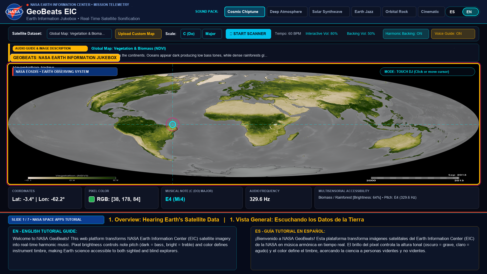
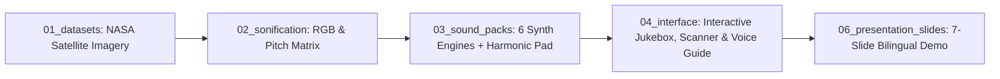

# 🌍 GeoBeats: Earth Information Jukebox (NASA Space Apps Challenge)

> **Official Project Repository & 7-Slide Demonstration (English / Español)**
> - 📊 **[View 7-Slide Project Demonstration (EN / ES Tutorial)](./06_presentation_slides/README.md)**
> - 📄 **[Download 7-Slide Presentation PDF (`GeoBeats_NASA_7_Slides.pdf`)](./06_presentation_slides/GeoBeats_NASA_7_Slides.pdf)**



---

## 🚀 Quick Start / Inicio Rápido

Run the local web server with Python 3 (no external dependencies required to launch the web interface):

```bash
python3 main.py
```

This automatically opens `http://localhost:8080/04_interface/index.html` in your browser.

### ✨ Key Features / Características Principales
- **Real-Time NASA Satellite Sonification:** Translates pixel RGB channels and luminance from 10 NASA Earth Observation datasets (MODIS, Terra, Aqua, VIIRS, Suomi NPP, OMI, GRACE) into harmonic musical compositions.
- **Full 7-Note Diatonic Scales across 12 Keys:** Explore in any of the 12 chromatic root keys (`C` through `B`) using Major or Natural Minor scales, accompanied by a generative low-volume harmonic pad.
- **6 Synthesizer Sound Packs:** *Cosmic Chiptune, Deep Atmosphere, Solar Synthwave, Earth Jazz, Orbital Rock,* and *Cinematic*.
- **Bilingual Accessibility (`🇺🇸 EN` / `🇪🇸 ES`) for Blind & Low-Vision Users:** Integrated Web Speech API voice guide reads a spoken onboarding tutorial and scientific descriptions of each satellite dataset. Press any letter key (`A–Z`) to stop or restart narration from the beginning, or `Spacebar` to start/stop the automated 32-step satellite scanner.

---

## 📂 Project Structure / Mapa de Carpetas del Proyecto

```text
SpaceChallenge/
├── 01_datasets/             -> NASA Earth Observation satellite imagery (MODIS, VIIRS, OMI, GRACE, Landsat)
├── 02_sonification/         -> RGB & Luminance to frequency/scale mathematical mapping engine
├── 03_sound_packs/          -> Multi-oscillator synthesizer profiles & harmonic progressions
├── 04_interface/            -> Interactive Web Audio API + HTML5 Canvas Earth Information Jukebox
├── 05_storytelling/         -> Impact documentation, pitch guide & multisensory accessibility
├── 06_presentation_slides/  -> Official 7-Slide NASA Space Apps Demonstration (PNGs + PDF + Bilingual Tutorial)
├── documentacion/           -> Theoretical framework, NASA EIC sources & educational rubric
└── main.py                  -> Zero-config local HTTP server launcher
```

---

## 🧭 Architecture Pipeline / Flujo de Información


